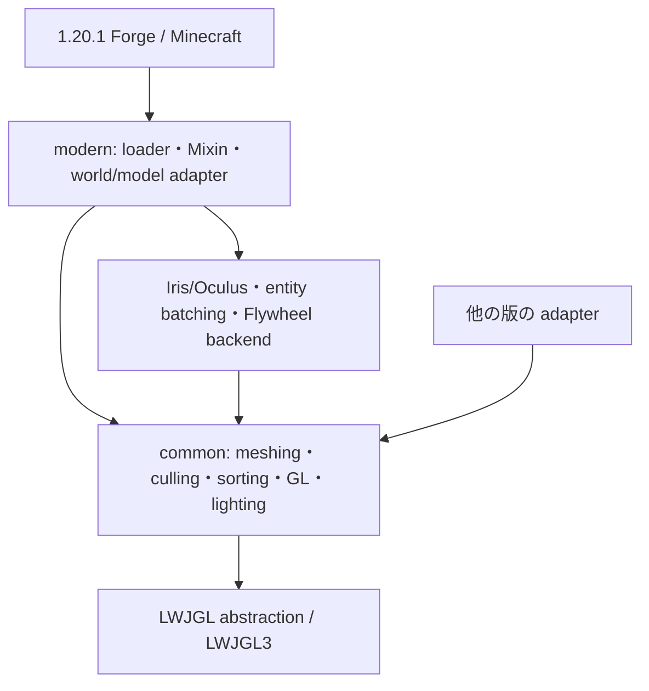

# Celeritas と現行 Embeddium のコードベース全体調査

調査日: 2026-11-16 (JST)。目的: Minecraft 1.20.1 Forge の最適化基盤を Celeritas に切り替える際の差分・引継ぎ条件を整理する。

## 結論

**Celeritas 本家には 1.20.1 Forge の実装があり、ソースから jar を生成できた。新しいベースとして利用する道筋はある。**
ただし、現在の Embeddium と同じ mod ID を使うことと、既存の jar／アドオンをそのまま置き換えられることは別である。
描画コア、shader 実装、API、設定の既定値、Java の出力設定が変わっている。

推奨する移行単位は **Celeritas の `common` と `modern/1.20.1-forge`、必要な shader source set を一体として採用すること**。
旧 renderer に共通クラスだけを継ぎ足す構成は、データ形式・thread 所有権・描画順の前提を混在させる。
まず本家の対象構成を基準にし、その後に既存アドオン用の互換層と、こちらの修正を明示的な差分として加える。

今回、現在の製品ソース・build 設定の切り替えは実施していない。調査用 checkout と build は `.git/research` 内に隔離した。
以下は速度の優劣や全 mod の互換性を保証するレポートではない。

## 比較対象・範囲・資料

| 対象 | 固定した revision |
| --- | --- |
| このフォークの `20.1/forge` | `63498d73d414f1e0f707b51c8a174eaedc6dc207` |
| Celeritas 本家 `stonecutter` | `26f000239eb8ddf7ee191f0ddf369147e3c92ef6` |

本家は [git.taumc.org/embeddedt/celeritas][cel-root]。`GTNewHorizons/Celeritas` の `nh-main` は別の下流 mirror／調整ブランチなので、今回の基準にはしていない。

全 tracked file の棚卸しと Java の対応候補探索を行い、主要 subsystem の実装・設定・呼び出し境界を確認した。
全メソッドの意味同値証明や、全1648 Java ファイルの個別動作試験をしたという意味ではない。

- [全ファイル一覧・493 Java ファイルの対応候補・分類データ](audits/celeritas-codebase-2026-11-16.json)
- [生成 jar・Java class version・API 宣言の比較資料](audits/celeritas-build-2026-11-16.json)
- 再生成用: `scripts/audit-celeritas-codebase.mjs`

| 棚卸し | 現行 | Celeritas |
| --- | ---: | ---: |
| tracked file | 574 | 1845 |
| Java file 全体 | 510 | 1648 |
| 現行の main／compat／legacy Java | 493 | — |
| 1.20.1 Forge の source set 構成から抽出した Java 候補 | — | 1329 |
| 上記のうち現行 source 上で主型宣言を検出した候補 | — | 1303 |

現行493ファイルについて、名前空間対応による候補351、同名クラスによる候補67、候補なし75を記録した。
108件は名前空間などを正規化した字句列が一致する。これは ABI 互換率や機能の維持率ではない。
候補なしには、改名・分割・別方式への置換・古い互換 shim・GameTest も含まれる。「75機能が削除された」という意味にはならない。
source set の候補一覧はコンパイラーの厳密な source map ではなく、生成 source や shaded dependency は別扱い。

本家 README は LGPL-3.0 と、Sodium 0.5.11以前／Oculus・Iris 系を使う方針を明記し、Sodium 0.5.12以降・0.6以降のコードは採用しないとしている。
root の COPYING.LESSER は LGPL v3。bitraster の同梱 LICENSE は Apache-2.0、Reese's Sodium Options 由来部分は MIT。
切り替え時は root のライセンスだけでなく、各同梱部分の表示も維持する。本家 README はソース主体の実験的な運用であることも説明している。
同 README では公式の製品 jar release はないとされているため、第三者配布 jar ではなく、固定した本家 source を取り込みの基準にする。

## 1. リポジトリ・build・対応版

現行は Minecraft 1.20.1 に固定した単一プロジェクトで、main に旧 Sodium namespace、Embeddium 拡張、Mixin が集まる。
compat／legacy source set を jar に追加し、ModDevGradle legacy、Gradle 8.10、Java 17 を使う。

Celeritas は [settings][cel-settings] に対象版を列挙し、Stonecutter の条件付き source と複数 loader を使う。

| 層 | 内容 |
| --- | --- |
| `common` | Minecraft に依存しない terrain、可視性、ソート、GL、lighting、設定 framework。main Java 302ファイル。 |
| `common/lwjglCommon`・`lwjgl2`・`lwjgl3` | メモリー／GL／debug 機能の backend と生成 abstraction。旧版対応のための層。 |
| `modern` | Minecraft／Forge／Fabric／NeoForge の world・model・Mixin・GUI・loader adapter。 |
| `modern/shaders*`・`batching`・`flywheel` | Iris/Oculus 系、entity batching、Flywheel shader backend。対象版によって選択。 |
| `forge122`・`forge1710`・`ornithe` | 共通 renderer に接続する他のゲーム版の adapter。今回の直接の採用対象ではない。 |
| `plugins`・`buildSrc` | access widener→AT、SRG remap、Mixin remap、version・dependency・source-set conventions。 |

1.20.1 Forge は最初から対象にあり、Forge は現行と同じ **47.3.0**。
一方で Gradle 9.7.1、daemon 用 Java 25、通常の modern／common 用 toolchain Java 21、TauMC の ModDevGradle fork を使う。
単に現行の依存バージョンを更新する形では置き換わらない。[build 設定][cel-mdg] [共通 build][cel-common-build]



## 2. Java 17 は build 設定だけでは完了しない

標準設定で生成した 1.20.1 Forge jar は 4,446,544 bytes、class 2294個。
class major version は65が1328個、61が516個、52が364個、49が86個だった。shaded dependency を含む数。
entry point の `Celeritas.class` も65、つまり Java 21 向けである。

Java 17 で entry point のロードを試すと、`UnsupportedClassVersionError`（65.0に対し最大61.0）になる。
Minecraft が Java 17 で動くことや、README の説明だけを根拠に、この標準 jar を Java 17 対応とは扱えない。

追加の build-only probe で確認した結果:

| 試験 | 結果 |
| --- | --- |
| modern/1.20.1-forge の compileJava に `--release 17` を指定 | 成功 |
| common にも `--release 17` を指定して packageJar／common:test | common のコンパイルで失敗 |
| 具体的な不適合 | [TextComponent.java:24][cel-text] の `List.getFirst()` が Java 17 にない |

common は class の target を17にしていても、Java 21 toolchain で利用できる API まで制限していない。
**class major が61以下であることだけでも、Java 17 対応の証明にはならない。**
Java 17 を維持する場合は、対象 modern と common の両方に release 制約を設け、API 使用の互換対応と、生成物・依存・ゲーム起動の検証が必要。
source を改変してこの不適合を直す作業は今回は行っていない。probe 後も本家 checkout の tracked source は無変更。

## 3. world renderer とメッシュ管理の境界

現行 `SodiumWorldRenderer` は world、block entity、可視性、meshing、draw の管理が密に結び付く。
Celeritas は [SimpleWorldRenderer][cel-world] と common の RenderSectionManager を基盤に、modern の CeleritasWorldRenderer／section manager で Minecraft 型を扱う。

`BuiltSectionInfo` の役割も BuiltRenderSectionData／MinecraftBuiltRenderSectionData に分かれ、section の visual metadata、sprite、block entity の更新が可視性リストへ伝播する。
旧 manager と新 list/cache を部分的に混ぜると、更新の invalidation と寿命管理の前提が合わない。

## 4. 可視性探索・非同期化・raster culling

現行は RenderSectionManager と OcclusionCuller による可視性 graph を中心に更新する。
Celeritas は [SectionGraph][cel-graph]／RenderListManager／SectionLattice を使い、terrain と shadow のリストを分離する。

- search 用の単一 executor を共有する。
- search 中は structural mutation を避け、metadata の変更を待機・遅延適用する。
- upload 前に graph 更新の終了を待つなど、render thread との同期点が増える。
- [RasterOccluder][cel-raster] と bitraster を使い、box の software rasterization による追加遮蔽判定を持つ。

既定値は `asyncOcclusionMode = ONLY_SHADOW`、`useRasterOcclusionCulling = false`。
main terrain の探索が常に非同期になるわけでも、raster culling が標準で動くわけでもない。
可視性が変わるため、穴・境界・高速移動・teleport・resource reload・shader shadow のテストが移行条件になる。

## 5. 半透明ソート V3

現行の terrain は TranslucentQuadAnalyzer の NONE／STATIC／DYNAMIC と、quad 中心を使った再ソートを持つ。
今回のフォークでは汎用 VertexSorters に大きな配列用の radix sort も導入した。

Celeritas は [TranslucentQuadRecorder・SortState][cel-sort] により、NONE／STATIC／TREE／DYNAMIC を扱う。
topological ordering、PartitionTree、cut plane の通過判定、動的 fallback を組み合わせ、単なる距離配列ソートとは異なる。
状態・mesh の index buffer・再ソートの発火条件・古い build result の扱いまで一組で変わる。

このため V3 を保持したまま、現行の radix sort だけを terrain 全体へ一律に適用する設計にはしない。
別に残る modern の汎用 VertexSorters は、確認した版では MergeSort を使う。

## 6. render pass・material・draw command

現行は DefaultTerrainRenderPasses／DefaultMaterials の固定構成を中心にする。
Celeritas は [RenderPassConfiguration と modern の builder][cel-pass] で、vanilla の stage、material、vertex layout、primitive type、sampling を結び付ける。

- tripwire を独立した pass として扱う。
- `useRenderPassConsolidation` で cutout 系 pass のまとめ方を選ぶ。既定値は true。
- 各 pass の vertex type と primitive type を持つ。
- [CachedBatch／BatchAssembler][cel-batch] により、view ごとに region の draw command と tessellation を再利用する。
- sorted pass と unsorted pass では組み立て・merge の扱いが異なる。

以前保留した Embeddium PR #581 と同じクラスを追加する必要はなく、Celeritas 側の cache・invalidation 設計を基準にする。
同じ「draw cache」でも、現行の public native pointer、buffer 更新、shader pass の前提をそのまま当てはめない。

## 7. vertex 形式・GPU 側の読み出し

現行は1頂点単位の encoder と固定 stride の compact／vanilla-like 形式を中心にする。
Celeritas は [ChunkVertexLayout と VertexFetchMode][cel-fetch] により、attributes と texture buffer を用いた vertex pulling を扱う。
vertex fetching 用 GLSL も生成する。

[QuadRelativeChunkVertex][cel-quad-relative] は quad の header と4頂点を合わせた88 bytesの形式で、位置・UV精度と共有データを設計し直している。
shader 用 XHFP がこれを基礎に使う。標準の非 shader terrain が常にこの形式になるわけではない。
通常の terrain は compact／vanilla-like の選択が残り、pulling の優先指定も別の system property である。

ChunkMeshBufferBuilder の `push` は「ちょうど1 primitive」の頂点数を要求し、encoder も writePrimitive 単位になる。
現行テストのように複数 quad を1配列でまとめて push する入力は、そのままでは新契約に合わない。
encoder だけを移す、または旧 byte 比較の期待値を維持するのではなく、shader decode・index 生成・layout を同じ基準で検証する。

## 8. worker・snapshot・割り当て・計測

ChunkBuilder は task の実行時間・frame 間隔・sort/mesh 比率を扱う scheduling controller と metrics を持つ。
ただし確認した版の `ENABLE_ADAPTIVE_SCHEDULING` は **false**。既定では固定 budget の経路が使われる。
新しい controller がソースにあるだけで、標準動作の性能改善とは数えない。

cache の例として、ClonedChunkSectionCache は使用順で cleanup を打ち切るが、上限は現行512に対して2048。
acquire の synchronized 有無も異なる。main thread、worker、graph thread の役割と一緒に評価する。
stale result の metadata と translucency state の扱いも現在の manager と異なる。

## 9. immediate rendering・BufferBuilder

[BufferBuilderMixin][cel-fast] は fast vertex の attribute binding・written state・直接書き込みを内包し、FastVertexBuilder／FastVertexExtension を使う。
現行の ExtendedBufferBuilder＋SodiumBufferBuilder delegate と同じ内部構造ではない。
capacity の幾何拡張、未完了 vertex と bulk push の状態確認も持つ。

1.20.1 の `canUseIntrinsics()` は cache した `embeddium$fastFormat` を返し、こちらで追加した live な `buffer != null` 判定と同じ形ではない。
format API も CommonVertexAttribute を引数に取る形式から Minecraft の VertexFormatElement を使う形式に変わる。
既存の null buffer 回帰テストの目的は引き継ぐが、旧 private field 名へテストを無理に合わせる構成にはしない。

## 10. block／fluid／FRAPI／lighting

modern の block renderer は共通 [BakedQuadGroupAnalyzer][cel-quad-group] を使い、material の決定と geometry 出力を分離している。
alpha、層順序、reorientation の制約はあるが、opaque quad の最適 material への振り分けなどが現行と完全には同じでない。

custom renderer は新しい vertex consumer の寿命管理を使い、close／flush を行う。
fluid は vanilla／Forge・Fabric の出力捕捉を専用 adapter へ分け、ModelDataSnapshotter と WorldSlice の構成も変わる。
現行の SinkingVertexBuilder や model context を型名だけ変更して接続する対象ではない。

FRAPI／Indigo は残るが source set・FFAPI module の版・render context の接続が変わる。
1.20.1 Forge の compile-time FFAPI 指定は `0.92.2+1.11.8+1.20.1`。これを即座に新しい必須 runtime dependency と解釈しない。

common の lighting は DiffuseProvider と scalar 座標を受け取り、Minecraft の照度取得は modern adapter に分ける。
現行の ForgeLightPipeline を使う分岐は、共通 LightPipelineProvider にはない。
ModelQuadFlags には canonical vertex order の判定も加わり、lighting のための quad の扱い自体が変わる。
quad normal shading の既定値も変わるため、AO／発光／非軸平行モデル／Forge 実験 lighting は個別に比較する。

## 11. shader・entity batching・Flywheel

現行にも terrain 用 GLSL はあるが、shader pack を動かす Iris/Oculus 本体は持たず、ShaderModBridge と外付け Oculus を前提に連携する。
Celeritas の1.20.1は shader source set が有効で、Iris/Oculus、entity batching、Flywheel shader backend を同じ build に含む。[shader conventions][cel-shaders]
選択した source 候補のうち shader／batching／Flywheel 関係だけで705 Javaファイルある。

生成 jar に `net.irisshaders.iris.Iris` があり、`iris` という mod stub も宣言される。
DH API、Flywheel、Indigo／Indium／Pixelmon 等の連携 Mixin も入る。
外付け Oculus と shader classes／Mixin の所有権が重なるため、併用してよい前提では移行しない。

Flywheel は1.0.6以上を optional dependency として宣言し、Colorwheel は不適合な依存範囲で排他にしている。
Create／Flywheel／shader の組み合わせは新しい構成で検証する。compiled class があることは実機での正常描画の証拠ではない。

## 12. 公開 API と既存アドオンの ABI

ソースの対応候補だけでなく、生成 jar の API namespace と `javap -public -s` の宣言を比較した。
対象範囲は `net.caffeinemc.mods.sodium.api`、`org.embeddedt.embeddium.api` と4個の legacy vertex shim。

- 現行の対象 class は51個。そのうち Celeritas に同じFQNがあるものは15個、ないものは36個。
- Celeritas の `net.caffeinemc.mods.sodium.api` class は0個。
- `me.jellysquid...` では SpriteUtil の互換 class はあるが、旧 renderer／vertex writer namespace 全体を維持してはいない。
- 共通FQN15個のうち、printed public declaration は6個が一致、9個が相違。宣言の差をすべて binary failure と同一視しない。

ABI 差が具体的に確認できる例:

| 既存名 | 相違 |
| --- | --- |
| BlockRendererRegistry.Renderer.renderBlock | BlockRenderContext の package／型が変わり、method descriptor が異なる。 |
| ChunkMeshEvent.BUS／ChunkDataBuiltEvent.BUS | field の型が `org.embeddedt...api.eventbus` から `org.taumc.celeritas.api.eventbus` へ変わり、descriptor が異なる。 |
| VertexFormatDescription | package に加え、attribute 引数の型と getElements の契約が変わる。 |
| 設定画面 events／options | `org.taumc.celeritas.api` の Minecraft 非依存 framework に移る。 |

そのままの class loading で旧 descriptor を参照するアドオンは互換ではない。
さらに [common の EventHandlerRegistrar][cel-eventbus] の platform event 投稿部は false を返す実装で、旧 Embeddium の Forge Event 継承・投稿と同じではない。
単なる import 置換だけで解決したことにせず、event registration・dispatch と context adapter を含めて検証する。
SectionInfoBuilder、FlawlessFramesService など宣言が保たれるものもあり、全 API が消えたわけではない。
impl package や Mixin の private field／LVT に直接依存するアドオンは、公開 API の shim だけで互換になるとも限らない。

## 13. mod 互換・設定・翻訳・診断

ImmersiveEngineering と BrandonsCore の互換実装は新しい場所にもあり、生成 jar にも入っていた。
CCL は旧専用 bootstrap から別の連携形へ移り、確認した Celeritas の CCL mixin 自体には1.21.1限定部分がある。
1.20.1 CCL の新しい側の連携契約まで含めて確認し、クラス名の消失だけで対応削除と断定しない。

mod ID は両者とも `embeddium`。現行の mods.toml は `rubidium` stub を持つが、Celeritas の標準成果物は `iris` stub を持ち、rubidium stub はない。
併存可能とは扱わず、addon の mod-ID 検出と multiplayer の client-only handshake も新構成で確認する。

| 設定 | 現行の既定値 | Celeritas の既定値 |
| --- | --- | --- |
| compact vertex | true | false |
| quad normal shading | false | true、serialized key も v2 に変更 |
| render-pass consolidation | 項目なし | true |
| async occlusion | 項目なし | ONLY_SHADOW |
| raster occlusion | 項目なし | false |
| chunk fade | 項目なし | 0 |
| RGSS terrain filtering | 項目なし | false |
| faster clouds の選択項目 | 項目なし | true |

値の根拠は [SodiumGameOptions][cel-options]。項目がないことは、現行に当該分野の最適化が一切ないという意味ではない。
設定ファイル名は両方 `embeddium-options.json`。既存設定を読む場合と新規 default の場合で出発点が変わる。
RGSS、fade、faster clouds は独立した描画変更として扱う。設定 UI の TextComponent／DrawContext／OptionStorage も新 framework へ移る。
現行の韓国語・ロシア語追加とスペイン語補完は別途引継ぎが必要。Celeritas の Iris 用翻訳があっても Embeddium/Sodium namespace の翻訳を代替しない。

現行の fingerprint、integrity／taint、resource-pack warning のクラス群には一対一の候補がないものがある。
Celeritas の loader services・Mixin config・post-launch 検査との責務対応を確認してから、診断を残すか置換する。

## 14. このフォークで既に取り込んだ変更の引継ぎ

| 現行の変更 | Celeritas で確認した状態 | 移行時の扱い |
| --- | --- | --- |
| upload の stream／割り当て削減 (#575) | GlBufferArena／RenderRegionManager に stream の経路が残る | 新しい PendingUpload・invalidation の構造へ再適用する候補。 |
| LRU cleanup 打切り (#576) | 同じ早期打切りを持つ。ただし上限・同期条件が異なる | 重複移植せず、新実装の条件をテストする。 |
| serializer snapshot (#578) | [VertexSerializerRegistryImpl][cel-serializers] の cache hit も read lock を取る | bundled Iris の登録処理と合わせて再検討する候補。 |
| 汎用 radix sort (#580) | modern VertexSorters は MergeSort | 汎用 sorter への移植候補。terrain V3 は別の基準で扱う。 |
| 翻訳追加・補完 | 対応する Embeddium/Sodium 全ファイルは揃わない | 新キーとの対応を検査して引き継ぐ。 |
| Forge biome effects getter 修正 | [BiomeMixin][cel-biome] は specialEffects を直接読む | Polytone 等の回帰を防ぐために引継ぎ対象。 |
| chunk buffer の遅延確保・byte capacity | Celeritas も同じ基本方針。primitive 単位へ発展 | 新契約に合わせてデータ検証を移す。 |
| 多層 quad の pass 最適化修正 | BakedQuadGroupAnalyzer へ抽出・拡張されている | 新アルゴリズムを保持し、元の120系列テストを適応する。 |
| null buffer の intrinsic 可否修正 | fast-format cache による別判定 | null状態・初期化・再計算の回帰テストを新 lifecycle で行う。 |
| adaptive CPU/GPU wait＋Intel check 撤去 | [RenderAheadManager][cel-frame] は Long.MAX_VALUE 待機、Intel scanner も残る | 引継ぎ対象。移植先は common manager と modern pre-launch。 |
| AMD #549 | このフォークでは撤去済み | 再導入しない。今回の比較で GPU workaround を追加しない。 |

「Celeritas のほうが新しいので、既存修正はすべて含まれる」という扱いはできない。
逆に、現行の private field や旧データ形式を新実装へ戻してテストを通すこともしない。
特に wait manager は frame ごとの引数、現在の loop は fence 間での options 再取得という境界差もある。

## 15. 実施した build・テストと未確認事項

本家 checkout は shallow clone なので version は `2.5.0-dev` と表示された。判定の基準は version 文字列ではなく固定 SHA。
標準設定の packageJar と common:test は成功した。common の4テストクラス、計43件が成功。
RasterBudget、AtlasEdgeMask、QuadRelativeChunkVertex、VertexFetchGenerator の検証である。

一方、[MDG build][cel-mdg] は Forge で modern の test source を空にし、test task を無効にしている。
この43件を1.20.1 Forge 本体・shader・Mixin・全 mod 互換の検証とは扱わない。
remap では TextureManager の2メソッドと EntityRenderDispatcher.renderOffsetShadow に警告も出た。
警告だけで不具合と断定せず、実 client の Mixin audit と該当経路の試験対象にする。

未実施: Celeritas の実 client 起動、実ワールド、外部 Oculus の併用、shader pack、Create/Flywheel/DH、全旧アドオン、multiplayer、FPS／frame time の比較。
現在のフォークは製品コードを変更していないため、既存の40件を今回もう一度実行する変更は加えていない。

## 16. 推奨する切り替え順序

1. 固定 Celeritas revision を別の作業ブランチ／checkout の基準にし、multi-module 構成を維持して1.20.1 Forgeだけを対象にする。
2. Java 21 を採用するか、現行どおり Java 17 を維持するかを決める。後者は release 制約・common API 修正・生成物検査を先に完了させる。
3. 本家 Celeritas の初期状態で client・shaderなし／あり・resource reload・world/dimension切替・translucency・mod-ID/network を確認する。
4. 必要な既存アドオンを列挙し、public API・event bus・context 用の互換層を独立した差分として設計する。
5. 上の引継ぎ表に従って、こちらの修正を1件ずつ適用する。旧ソースとの一致スクリプトは履歴として残し、Celeritas 基準の検証へ切り替える。
6. 同じ環境・world・描画設定で profiling し、cache hit lock、upload 割り当て、可視性探索、sort trigger、worker budget の実際のボトルネックから最適化する。

common だけを現行 renderer に差し込む案は、SimpleWorldRenderer・BuiltRenderSectionData・RenderPassConfiguration・primitive layout・thread 同期の adapter を自作する必要がある。
この構成では作者の実装をそのまま保つ目的から離れやすいため、今回の目的では modern 対象ごと切り替える案を優先する。

## 再現方法

```powershell
git clone --depth 1 --branch stonecutter https://git.taumc.org/embeddedt/celeritas.git .git/research/celeritas
node scripts/audit-celeritas-codebase.mjs .git/research/celeritas docs/audits/celeritas-codebase-2026-11-16.json 63498d73d414f1e0f707b51c8a174eaedc6dc207 26f000239eb8ddf7ee191f0ddf369147e3c92ef6
$env:JAVA_HOME = 'C:/Program Files/Eclipse Adoptium/jdk-25.0.4.101-hotspot'
./.git/research/celeritas/gradlew.bat --project-dir .git/research/celeritas --gradle-user-home D:/DevCache/Gradle/celeritas-audit '-Pceleritas_target_versions=1.20.1' '-Pceleritas_target_subprojects=modern' ':modern:1.20.1-forge:packageJar' ':common:test' --no-daemon
```

Java 17 の全体 probe は、上の Gradle コマンドに `-I (Resolve-Path scripts/celeritas-java17-audit.init.gradle).Path` を加える。
この init script は別の調査 checkout に明示的に指定するもの。現行プロジェクトの通常 build には適用していない。
固定した snapshot では common の List.getFirst で失敗するのが今回確認した結果。

snapshot が更新された場合は、対象 SHA の git object を取得してから比較する。API 宣言・class version の根拠は build JSON に保存した。
調査用の標準 jar は `.git/research/celeritas-artifacts/java21` に退避している。非公開のローカル成果物で、配布・公式 release として扱わない。
push・公開・現在の runtime への組込みは行っていない。

[cel-root]: https://git.taumc.org/embeddedt/celeritas/src/commit/26f000239eb8ddf7ee191f0ddf369147e3c92ef6/README.md
[cel-settings]: https://git.taumc.org/embeddedt/celeritas/src/commit/26f000239eb8ddf7ee191f0ddf369147e3c92ef6/settings.gradle.kts
[cel-mdg]: https://git.taumc.org/embeddedt/celeritas/src/commit/26f000239eb8ddf7ee191f0ddf369147e3c92ef6/modern/build.mdg.gradle.kts
[cel-common-build]: https://git.taumc.org/embeddedt/celeritas/src/commit/26f000239eb8ddf7ee191f0ddf369147e3c92ef6/common/build.gradle
[cel-text]: https://git.taumc.org/embeddedt/celeritas/src/commit/26f000239eb8ddf7ee191f0ddf369147e3c92ef6/common/src/main/java/org/embeddedt/embeddium/impl/gui/framework/TextComponent.java#L24
[cel-world]: https://git.taumc.org/embeddedt/celeritas/src/commit/26f000239eb8ddf7ee191f0ddf369147e3c92ef6/common/src/main/java/org/embeddedt/embeddium/impl/render/terrain/SimpleWorldRenderer.java
[cel-graph]: https://git.taumc.org/embeddedt/celeritas/src/commit/26f000239eb8ddf7ee191f0ddf369147e3c92ef6/common/src/main/java/org/embeddedt/embeddium/impl/render/chunk/lists/SectionGraph.java
[cel-raster]: https://git.taumc.org/embeddedt/celeritas/src/commit/26f000239eb8ddf7ee191f0ddf369147e3c92ef6/common/src/main/java/org/embeddedt/embeddium/impl/render/chunk/occlusion/RasterOccluder.java
[cel-sort]: https://git.taumc.org/embeddedt/celeritas/src/commit/26f000239eb8ddf7ee191f0ddf369147e3c92ef6/common/src/main/java/org/embeddedt/embeddium/impl/render/chunk/sorting/SortState.java
[cel-pass]: https://git.taumc.org/embeddedt/celeritas/src/commit/26f000239eb8ddf7ee191f0ddf369147e3c92ef6/modern/src/main/modern_java/org/embeddedt/embeddium/impl/modern/render/chunk/config/ModernRenderPassConfigurationBuilder.java
[cel-batch]: https://git.taumc.org/embeddedt/celeritas/src/commit/26f000239eb8ddf7ee191f0ddf369147e3c92ef6/common/src/main/java/org/embeddedt/embeddium/impl/render/chunk/multidraw/BatchAssembler.java
[cel-fetch]: https://git.taumc.org/embeddedt/celeritas/src/commit/26f000239eb8ddf7ee191f0ddf369147e3c92ef6/common/src/main/java/org/embeddedt/embeddium/impl/render/chunk/vertex/format/VertexFetchMode.java
[cel-quad-relative]: https://git.taumc.org/embeddedt/celeritas/src/commit/26f000239eb8ddf7ee191f0ddf369147e3c92ef6/common/src/main/java/org/embeddedt/embeddium/impl/render/chunk/vertex/format/impl/QuadRelativeChunkVertex.java
[cel-fast]: https://git.taumc.org/embeddedt/celeritas/src/commit/26f000239eb8ddf7ee191f0ddf369147e3c92ef6/modern/src/main/modern_java/org/embeddedt/embeddium/impl/mixin/core/render/immediate/consumer/BufferBuilderMixin.java
[cel-quad-group]: https://git.taumc.org/embeddedt/celeritas/src/commit/26f000239eb8ddf7ee191f0ddf369147e3c92ef6/common/src/main/java/org/embeddedt/embeddium/impl/render/chunk/compile/pipeline/BakedQuadGroupAnalyzer.java
[cel-shaders]: https://git.taumc.org/embeddedt/celeritas/src/commit/26f000239eb8ddf7ee191f0ddf369147e3c92ef6/buildSrc/src/main/kotlin/celeritas.shader-conventions.gradle.kts
[cel-eventbus]: https://git.taumc.org/embeddedt/celeritas/src/commit/26f000239eb8ddf7ee191f0ddf369147e3c92ef6/common/src/main/java/org/taumc/celeritas/api/eventbus/EventHandlerRegistrar.java
[cel-options]: https://git.taumc.org/embeddedt/celeritas/src/commit/26f000239eb8ddf7ee191f0ddf369147e3c92ef6/common/src/main/java/org/embeddedt/embeddium/impl/gui/SodiumGameOptions.java
[cel-serializers]: https://git.taumc.org/embeddedt/celeritas/src/commit/26f000239eb8ddf7ee191f0ddf369147e3c92ef6/modern/src/main/modern_java/org/embeddedt/embeddium/impl/render/vertex/serializers/VertexSerializerRegistryImpl.java
[cel-biome]: https://git.taumc.org/embeddedt/celeritas/src/commit/26f000239eb8ddf7ee191f0ddf369147e3c92ef6/modern/src/main/modern_java/org/embeddedt/embeddium/impl/mixin/features/world/biome/BiomeMixin.java
[cel-frame]: https://git.taumc.org/embeddedt/celeritas/src/commit/26f000239eb8ddf7ee191f0ddf369147e3c92ef6/common/src/main/java/org/embeddedt/embeddium/impl/render/frame/RenderAheadManager.java
